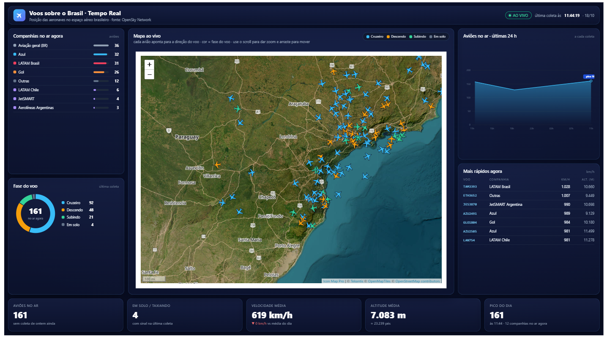
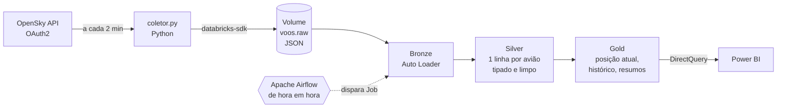

# ✈️ Voos sobre o Brasil – Pipeline em Tempo Real

Pipeline de dados que acompanha **as aeronaves no espaço aéreo brasileiro** quase em tempo real: coleta a posição dos aviões na **API da OpenSky Network (OAuth2)**, processa de forma **incremental** no **Databricks** em arquitetura medalhão, é orquestrado pelo **Apache Airflow** e termina em um painel **Power BI** com mapa ao vivo.



---

## 🏗️ Arquitetura



| Etapa | O que faz | Destaques |
|---|---|---|
| **Coletor** | Consulta a API para o retângulo do Brasil e grava cada resposta em JSON | Token OAuth2 renovado automaticamente, tratamento de cota (HTTP 429), reenvio de arquivos que falharam |
| **Bronze** | Ingestão dos JSONs exatamente como vieram | **Auto Loader** com checkpoint: processa só os arquivos novos |
| **Silver** | Abre a lista de aeronaves (1 linha por avião por coleta) | Tipagem, conversão de m/s → km/h, horário de Brasília, remoção de registros sem posição, leitura incremental da bronze |
| **Gold** | Tabelas prontas para o painel | Companhia pelo prefixo do voo, fase do voo, posição atual, histórico e totais por coleta |

---

## 🧰 Tecnologias

- **Python** – coleta da API (`requests`, `python-dotenv`, `databricks-sdk`)
- **Databricks Free Edition** – PySpark, Delta Lake, Unity Catalog, **Auto Loader** e Jobs (Serverless)
- **Apache Airflow 3** (Docker) – orquestração com `DatabricksRunNowOperator`
- **Power BI** – DirectQuery no SQL Warehouse, visual **HTML Content** gerado por DAX e mapa com **Icon Map Pro**

---

## 🔄 Fluxo em detalhe

### 1. Coleta (`coletor.py`)
- Autenticação **OAuth2 client credentials** na OpenSky; o token dura 30 min e é renovado 1 min antes de expirar.
- Consulta a cada **2 minutos** o retângulo do Brasil (custo de 4 créditos por chamada, dentro do limite diário da conta gratuita).
- Salva o JSON localmente e envia para `/Volumes/workspace/voos/raw/AAAA-MM-DD/`.
- Se o envio falhar, o arquivo entra em uma fila de pendentes e é reenviado na próxima volta.

### 2. Camadas no Databricks (`notebooks/`)

| Notebook | Tabela | Técnica |
|---|---|---|
| `01_bronze_voos` | `voos_bronze.posicoes_raw` | `readStream.format("cloudFiles")` + `trigger(availableNow=True)` |
| `02_silver_voos` | `voos_silver.posicoes` | `readStream.table` da bronze, `explode` das aeronaves, tipagem |
| `03_gold_voos` | `voos_gold.*` | Recriada a cada execução a partir da silver |

**Tabelas gold**

| Tabela | Uso no painel |
|---|---|
| `dim_companhia` | Prefixo do voo → companhia e tipo (nacional, internacional, carga) |
| `fato_posicoes` | Histórico de posições com companhia e fase do voo (rastros) |
| `posicao_atual` | Última coleta, uma linha por aeronave (mapa ao vivo) |
| `resumo_coleta` | Totais por coleta e companhia (KPIs e série das últimas 24 h) |

**Regras de negócio**
- **Companhia:** pelos 3 primeiros caracteres do voo (`TAM` → LATAM Brasil, `GLO` → Gol, `AZU` → Azul…); matrículas brasileiras (`PP/PR/PS/PT/PU` + 3 letras) viram *Aviação geral (BR)*.
- **Fase do voo:** em solo; subindo (taxa vertical > +2,5 m/s); descendo (< −2,5 m/s); cruzeiro (nivelado).

### 3. Orquestração (`dags/voos_medallion_dag.py`)
O Airflow dispara de hora em hora o Job `voos_medallion` (bronze → silver → gold).
`max_active_runs=1` evita duas execuções sobre o mesmo checkpoint e `catchup=False` ignora horários passados.

### 4. Power BI (`powerbi/`)
- Conexão **DirectQuery** no SQL Warehouse, com atualização automática da página.
- Painel em **HTML/CSS/SVG gerado por medidas DAX**: companhias no ar, fase do voo, aviões nas últimas 24 h, mais rápidos agora e KPIs.
- Mapa com **Icon Map Pro**: cada avião é um ícone SVG criado por DAX, **girado pela direção do voo** e **colorido pela fase**, sobre imagem de satélite, rodovias e a sombra de dia/noite.

---

## 📁 Estrutura do repositório

```
voos-brasil-tempo-real/
├── coletor.py                 # coleta contínua da API → volume do Databricks
├── teste_api.py               # teste de autenticação e de uma chamada
├── requirements.txt
├── notebooks/
│   ├── 01_bronze_voos         # Auto Loader
│   ├── 02_silver_voos         # explode + tipagem (streaming)
│   └── 03_gold_voos           # tabelas para o painel
├── dags/
│   └── voos_medallion_dag.py  # orquestração no Airflow
└── powerbi/
    ├── voos_tempo_real.pbip   # projeto Power BI (PBIP)
    ├── voos_tempo_real.Report/
    ├── voos_tempo_real.SemanticModel/
    └── img/
```

---

## ▶️ Como executar

### 1. OpenSky
1. Crie uma conta em [opensky-network.org](https://opensky-network.org) e gere um **API Client** em *Account*.
2. Crie um arquivo `.env` (não versionado) com:
   ```
   OPENSKY_CLIENT_ID=...
   OPENSKY_CLIENT_SECRET=...
   DATABRICKS_HOST=https://<seu-workspace>.cloud.databricks.com
   DATABRICKS_TOKEN=...
   ```

### 2. Databricks
```sql
CREATE SCHEMA IF NOT EXISTS workspace.voos;
CREATE VOLUME IF NOT EXISTS workspace.voos.raw;
CREATE SCHEMA IF NOT EXISTS workspace.voos_bronze;
CREATE SCHEMA IF NOT EXISTS workspace.voos_silver;
CREATE SCHEMA IF NOT EXISTS workspace.voos_gold;
```
Importe a pasta `notebooks/` (ou conecte o repositório via **Git folders**) e crie um Job com as 3 tarefas encadeadas.

### 3. Coletor
```bash
pip install -r requirements.txt
python teste_api.py     # valida a autenticação
python coletor.py       # inicia a coleta contínua
```

### 4. Airflow
1. Instale o provider `apache-airflow-providers-databricks`.
2. Crie a conexão `databricks_default` (host + token) e a variável `voos_job_id` com o ID do Job.
3. Copie `dags/voos_medallion_dag.py` para a pasta de DAGs.

### 5. Power BI
Abra `powerbi/voos_tempo_real.pbip`, aponte a fonte para o seu SQL Warehouse e instale o visual **Icon Map Pro** (AppSource).

---

## ⚠️ Limitações

- **Cobertura:** a OpenSky depende de receptores voluntários; a cobertura é boa no Sul e Sudeste e menor no Norte e Centro-Oeste.
- **Latência:** o painel reflete a última execução do Job (de hora em hora); a frequência pode ser aumentada na DAG, ao custo de mais uso de compute.
- **Coleta local:** o coletor roda na máquina local; com ela desligada não há novas coletas.

---

📄 Dados: [The OpenSky Network](https://opensky-network.org) · uso não comercial
